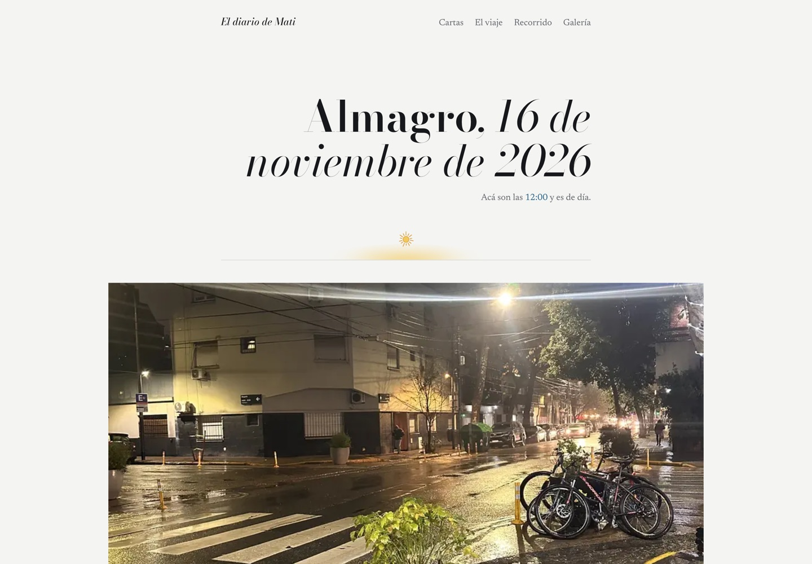
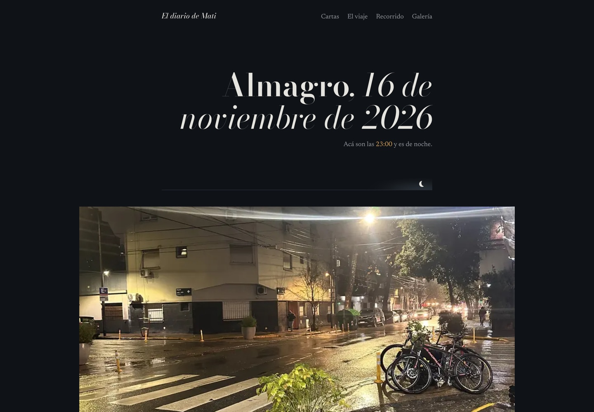

# El diario de Mati

Relatos, poemas y un año de viaje escrito semana a semana. El sitio se lee como un cuaderno de
cartas fechadas: el lugar y la fecha arriba a la derecha, el texto y la firma. La página toma la
luz de la hora del lugar desde donde escribo, así que no es la misma a las doce del mediodía que a
las once de la noche.

<p align="center">
  
  
</p>

Este repo es el frontend. El contenido se escribe en Notion y lo sirve el backend
`eddm-back-nextjs` (privado).

## Qué hay adentro

| Ruta                    | Qué es                                                            |
| :---------------------- | :---------------------------------------------------------------- |
| `/`                     | Desde dónde escribo hoy, la hora de allá y las últimas cartas     |
| `/cartas`               | El índice de todo, con la búsqueda por palabras (la concordancia) |
| `/viaje`                | El viaje 2024–2025, semana a semana; recuerda qué semanas leíste  |
| `/recorrido`            | El mapa del recorrido, parada por parada                          |
| `/galeria`              | Las fotos del viaje, por ciudad                                   |
| `/relatos`, `/poemas`   | La escritura que sigue                                            |
| `/mas-aca-en-el-tiempo` | Historias recientes, no necesariamente en orden                   |
| `/links`                | La página para compartir                                          |

### Las cuatro luces

`src/scripts/light.js` corre en el `<head>`, antes de pintar, y elige `data-phase` en `<html>`
según la hora del lugar (`timeZone`): `dawn` (6 a 9), `day` (9 a 18), `dusk` (18 a 21) y `night`.
Los colores son tokens de Tailwind (`paper`, `ink`, `muted`, `rule`, `lamp`) que cada luz
redefine en `src/styles/global.css`. Quien navega en modo oscuro nunca recibe la luz de día.

En desarrollo aparece un panel “Cielo” abajo a la izquierda para fijar otra hora y recorrer el día
sin esperar.

## Stack

- [Astro 7](https://astro.build) con `output: 'server'` y el adapter de Vercel; casi todas las
  páginas se prerenderizan y `/viaje/[slug]` se renderiza bajo demanda.
- Tailwind CSS 4, Bodoni Moda y Newsreader.
- `<script>` chicos dentro de cada `.astro` y nanostores para lo que vive en `localStorage`.
- `marked` para el Markdown, PhotoSwipe para la galería y `d3-geo` para el mapa.
- Imágenes en R2 (vía Vercel Image), Cloudinary e ImageKit.
- Content Security Policy con hashes (`security.csp` de Astro).

## Desarrollo

Hace falta Node 24 y pnpm.

```sh
pnpm install
pnpm dev        # http://localhost:4321
```

El sitio necesita el backend corriendo en `API_URL` (por defecto `http://localhost:5500`); sin él
las páginas salen vacías. Las variables van en `.env`, que no se versiona:

```sh
API_URL=http://localhost:5500
FRONTEND_API_KEY=...
LOG_TOKEN=...
```

| Comando                  | Qué hace                                   |
| :----------------------- | :----------------------------------------- |
| `pnpm dev`               | Servidor de desarrollo                     |
| `pnpm build`             | Build de producción (compila los `.astro`) |
| `pnpm preview`           | Sirve el build                             |
| `pnpm exec tsc --noEmit` | Revisa los tipos de los `.ts`              |
| `pnpm exec eslint src`   | Lint                                       |

## Estructura

```text
src/
├── pages/        rutas, una carpeta por sección
├── layouts/      Layout.astro: head, meta y el script de la luz
├── components/   share/carta (Dateline, Prose, Signature…), home, viaje, cartas, recorrido…
├── lib/
│   ├── api/      una función por endpoint; devuelven null en vez de lanzar
│   ├── adapters/ de la respuesta de la API al modelo de la UI
│   └── store/    nanostores
├── scripts/      light.js, el script del <head>
└── styles/       global.css con los tokens de las cuatro luces
```

Las reglas de trabajo (ramas, commits, validación, diseño) están en [`AGENTS.md`](AGENTS.md).
